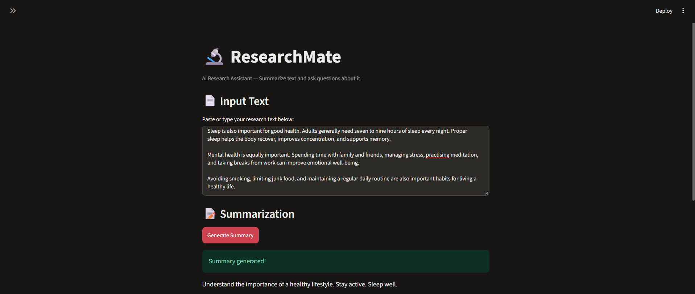
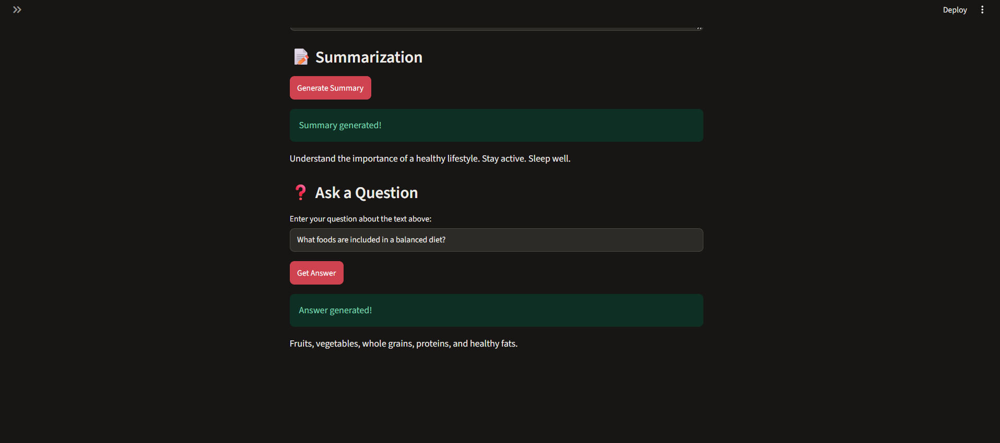

# 🔬 ResearchMate – AI Research Assistant

A lightweight Generative AI application that summarizes text and answers questions based on user-provided content.

ResearchMate uses a locally running Hugging Face pretrained language model integrated with LangChain. It allows users to summarize research material and ask questions about the provided text without requiring paid API services or API keys.

---

## ✨ Features

- **Text Summarization:** Generate concise summaries from user-provided text.
- **Context-Based Question Answering:** Ask questions and receive answers based on the supplied text.
- **Local Model Inference:** Run the language model locally using CPU or a compatible NVIDIA GPU.
- **No API Keys Required:** Uses an open-source pretrained Hugging Face model.
- **Input Validation:** Handles empty inputs and invalid requests.
- **Long-Text Handling:** Automatically truncates input to fit the configured token limit.
- **Unsupported Question Handling:** Provides a fallback response when the supplied context does not contain sufficient information.
- **Simple User Interface:** Easy-to-use interface built with Streamlit.

---

## 🖥️ Application Screenshots

### 1. Text Input and Summarization

Users can paste research material or other text and generate a concise summary.



### 2. Context-Based Question Answering

Users can ask questions related to the supplied text and receive answers generated by the language model.



---

## 🛠️ Technology Stack

| Component | Technology |
|---|---|
| Programming Language | Python 3.11 |
| Language Model | Google FLAN-T5 Base |
| LLM Framework | LangChain |
| Model Integration | Hugging Face Transformers |
| Deep Learning Framework | PyTorch |
| Frontend | Streamlit |
| Inference | Local CPU / NVIDIA CUDA GPU |
| Version Control | Git and GitHub |

---

## 🏗️ System Architecture

ResearchMate follows a simple processing pipeline in which the user interacts with the Streamlit interface, while the backend handles prompt preparation, model inference and output generation.

### Architecture Flow

```text
                 User
                   |
                   v
             Streamlit UI
                   |
                   v
                model.py
                   |
                   v
             LangChain LCEL
                   |
                   v
             PromptTemplate
                   |
                   v
          Hugging Face Pipeline
                   |
                   v
           google/flan-t5-base
                   |
                   v
             Generated Output
                   |
                   v
              Streamlit UI
```

### Working Process

1. The user enters text into the Streamlit application.
2. The application receives the input and passes it to the model-processing layer.
3. LangChain prepares the prompt using a PromptTemplate.
4. The Hugging Face pipeline sends the prompt to the FLAN-T5 model.
5. The model generates a summary or answer.
6. LangChain processes the generated output.
7. The final result is displayed to the user through Streamlit.

---

## 📁 Project Structure

```text
ResearchMate/
│
├── screenshots/
│   ├── home.png
│   └── question-answering.png
│
├── app.py              # Streamlit application interface
├── model.py            # Model loading and inference logic
├── requirements.txt    # Project dependencies
├── tests.py            # Application tests
├── README.md           # Project documentation
└── .gitignore          # Git ignored files
```

**Note:** The `.venv/` virtual environment and downloaded model cache are not included in the GitHub repository.

---

## ⚙️ Installation and Setup

### Prerequisites

- Python 3.11 or later
- Git
- Internet connection for the initial model download
- NVIDIA GPU with compatible CUDA support (optional)

The application can also run on a CPU without an NVIDIA GPU.

### Step 1: Clone the Repository

```bash
git clone https://github.com/YOUR_USERNAME/ResearchMate.git
```

Replace `YOUR_USERNAME` with your GitHub username after creating the repository.

### Step 2: Navigate to the Project Directory

```bash
cd ResearchMate
```

### Step 3: Create a Virtual Environment

```bash
python -m venv .venv
```

### Step 4: Activate the Virtual Environment

For Windows PowerShell:

```powershell
.\.venv\Scripts\Activate.ps1
```

If PowerShell blocks script execution, run:

```powershell
Set-ExecutionPolicy -Scope Process -ExecutionPolicy Bypass
```

Then activate the environment again.

### Step 5: Install Dependencies

```bash
python -m pip install --upgrade pip
python -m pip install -r requirements.txt
```

For NVIDIA GPU acceleration, use a PyTorch build compatible with your installed CUDA environment. Follow the official PyTorch installation guide:

https://pytorch.org/get-started/locally/

For CPU-only execution, install the CPU-compatible PyTorch build before running the application.

---

## ▶️ Running the Application

After installing the dependencies, execute:

```bash
python -m streamlit run app.py
```

The application will start locally.

Open the URL displayed in your terminal. The default address is:

```text
http://localhost:8501
```

The pretrained model is downloaded automatically from Hugging Face during its first load. Subsequent runs can reuse the locally cached model files.

---

## 📖 How to Use

### Text Summarization

1. Open the ResearchMate application.
2. Paste or type your research text into the input area.
3. Click the **Generate Summary** button.
4. Wait for the model to process the text.
5. View the generated summary.

### Context-Based Question Answering

1. Enter the text you want to ask questions about.
2. Type a question related to the supplied text.
3. Click the **Get Answer** button.
4. The model processes the question using the provided context.
5. View the generated answer.

**Example:**

Input Text:

```text
Machine Learning is a subset of Artificial Intelligence.
It allows computers to learn from data without being
explicitly programmed. The three main types of Machine
Learning are supervised learning, unsupervised learning,
and reinforcement learning.
```

Question:

```text
What are the three main types of Machine Learning?
```

Expected Answer:

```text
Supervised learning, unsupervised learning,
and reinforcement learning.
```

---

## 🤖 Model Details

ResearchMate uses the **google/flan-t5-base** pretrained language model.

| Property | Details |
|---|---|
| Model Name | google/flan-t5-base |
| Model Provider | Google Research |
| Parameters | Approximately 250 million |
| Architecture | Encoder-Decoder Transformer |
| Model Type | Text-to-Text Generation |
| Main Tasks | Summarization and Question Answering |
| License | Apache 2.0 |

### Why FLAN-T5 Base?

- It is an instruction-tuned pretrained language model.
- It supports text-to-text generation tasks.
- It can perform multiple tasks using natural language instructions.
- It can be integrated with Hugging Face Transformers.
- It supports local inference without requiring a paid API.

**Model Link:** https://huggingface.co/google/flan-t5-base

---

## 🔗 LangChain Integration

ResearchMate uses **LangChain Expression Language (LCEL)** to create reusable inference chains.

The following components are used:

### 1. PromptTemplate

Creates structured prompts for summarization and question answering.

### 2. HuggingFacePipeline

Connects the Hugging Face Transformers pipeline with LangChain.

### 3. StrOutputParser

Converts the generated model output into a string.

### 4. LCEL Pipe Operator

Connects different components into a single processing chain.

Example:

```python
chain = PROMPT | llm | StrOutputParser()
```

This creates a simple workflow:

```text
PromptTemplate → Language Model → Output Parser
```

---

## 🧪 Testing

The project includes tests for important application functionalities.

The test coverage includes:

- Text summarization.
- Question answering.
- Empty input handling.
- Whitespace-only input handling.
- Unsupported question handling.
- Token counting.
- Long-text truncation.
- Input validation.

Run the tests using:

```bash
python tests.py
```

---

## ⚠️ Known Limitations

- **Input Length:** The application uses a configured input-token budget of up to 512 tokens. Longer text is automatically truncated.
- **Summarization Quality:** Generated summaries may omit important details or nuances in complex text.
- **Question Answering Accuracy:** The model may generate incomplete or inaccurate answers, particularly for complex questions.
- **Context Dependency:** Answer quality depends on the relevance and completeness of the supplied text.
- **First Model Load:** An internet connection is required to download the model files initially.
- **Hardware Requirements:** Inference speed depends on available CPU, RAM and GPU resources.
- **No Persistent Storage:** The application processes user-provided text locally and does not provide a persistent document database.

---

## 🚀 Future Improvements

The following features can be considered for future versions:

- PDF and document upload support.
- Retrieval-Augmented Generation (RAG).
- Document embeddings and vector database integration.
- Conversation history and multi-turn question answering.
- Improved answer quality and evaluation.
- Support for larger documents.
- Deployment for wider accessibility.
- LangGraph-based agent workflows.

These are planned improvements and are not part of the current implementation.

---

## 📜 License and Acknowledgements

ResearchMate is an educational and portfolio project.

The application uses the `google/flan-t5-base` pretrained model, which is distributed under the Apache 2.0 license.

**Model:** https://huggingface.co/google/flan-t5-base

**Model License:** https://www.apache.org/licenses/LICENSE-2.0

Built using open-source technologies:

- Python
- Streamlit
- LangChain
- Hugging Face Transformers
- PyTorch

---

## 👨‍💻 Author

**Yash Shirsath**

BE – Artificial Intelligence and Data Science Engineering

GitHub: https://github.com/Yash091205

---

⭐ If you find this project useful, consider giving it a star on GitHub!